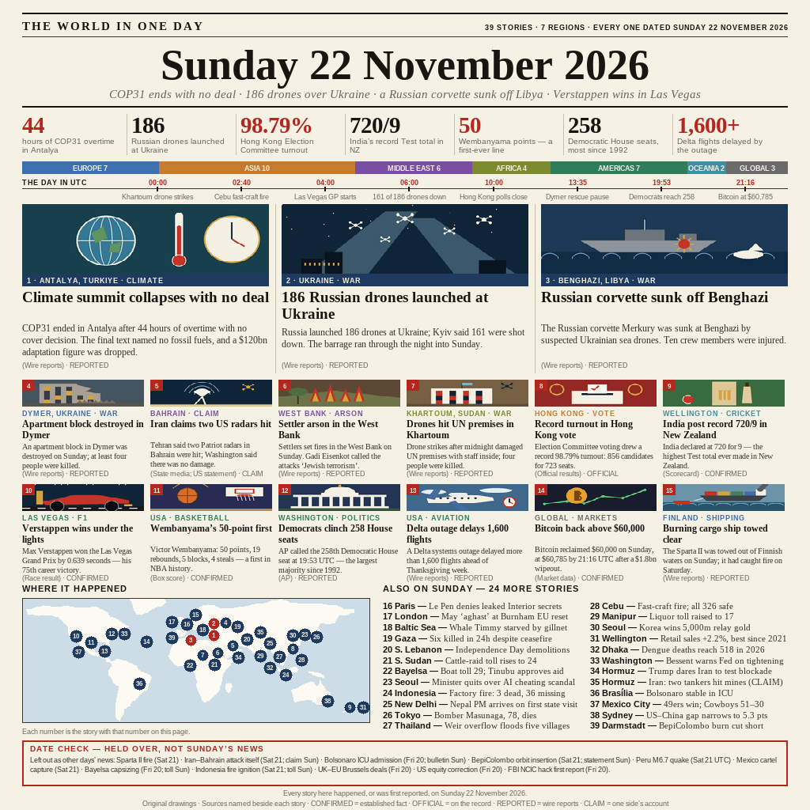

Entry for the [make.fun bounty "Sum up 22 November's world news in one image"](https://make.fun/bounty/news-image-20261122).

# Sunday 22 November 2026 — The World in One Day

`main.py` (Python standard library only) renders a cream broadsheet front page
for Sunday 22 November 2026 to `/output/entry.png`: 39 stories, every one of
them happened or first reported on that day, with a stat strip, a UTC
timeline, illustrated lead and news cards, a world map with a numbered pin
per story, and a DATE CHECK box listing the near-miss stories held over as
other days' news.

Run it with:

    mkdir -p out && MAKEFUN_OUTPUT_DIR=out python3 main.py

The glyph atlas, illustration sprites and landmask embedded in `main.py` were
pre-rendered offline; the program itself needs no network and no third-party
packages, and two runs write identical bytes.

