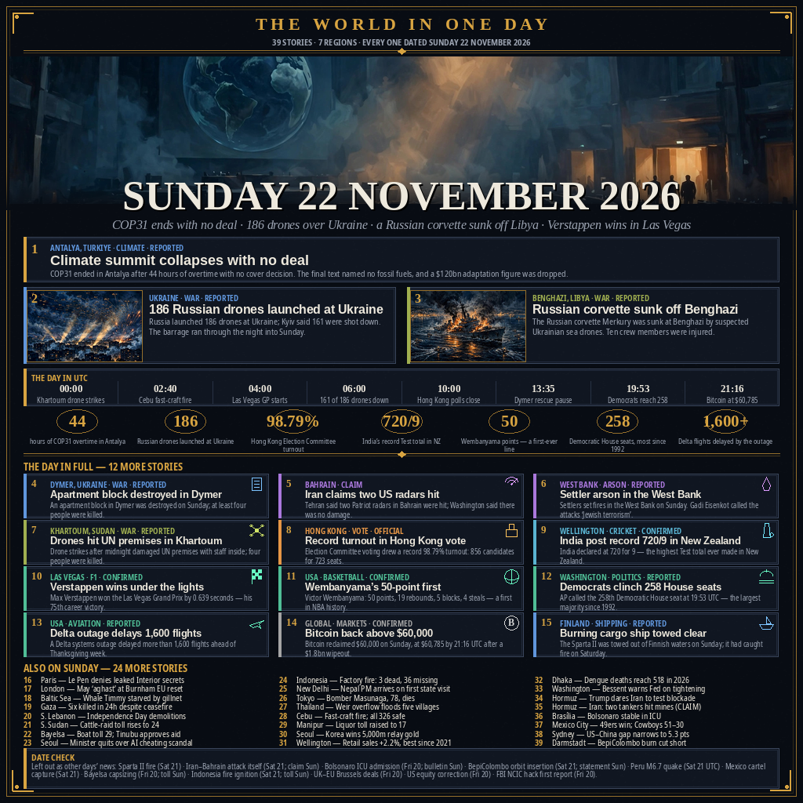

Entry for the [make.fun bounty "Sum up 22 November's world news in one image"](https://make.fun/bounty/news-image-20261122).

# Sunday 22 November 2026 — The World in One Day

`main.py` (Python standard library only) copies the pre-composed cinematic
poster for Sunday 22 November 2026 to `/output/entry.png`: 39 stories, every
one of them happened or first reported on that day, under three generated
scene illustrations (the COP31 collapse in Antalya, the 186-drone night over
Ukraine, the corvette Merkury sinking at Benghazi), with a stat strip, a UTC
timeline, illustrated lead and news cards, and a DATE CHECK box listing the
near-miss stories held over as other days' news.

Run it with:

    mkdir -p out && MAKEFUN_OUTPUT_DIR=out python3 main.py

The poster (`poster_v1.png`) was composed offline by `build_poster_v1.py`
from the generated artwork in `assets_v1/`; the entry program itself needs
no network and no third-party packages, and two runs write identical bytes.

